# AWS IAM-Based Access Management Environment

Role-based access control for an organization using AWS IAM. Separate groups and users are created for **Administrators**, **Developers**, and **Read-Only** staff, with least-privilege policies. The project demonstrates which AWS operations are **permitted** and which are **denied** for each role.

## Architecture

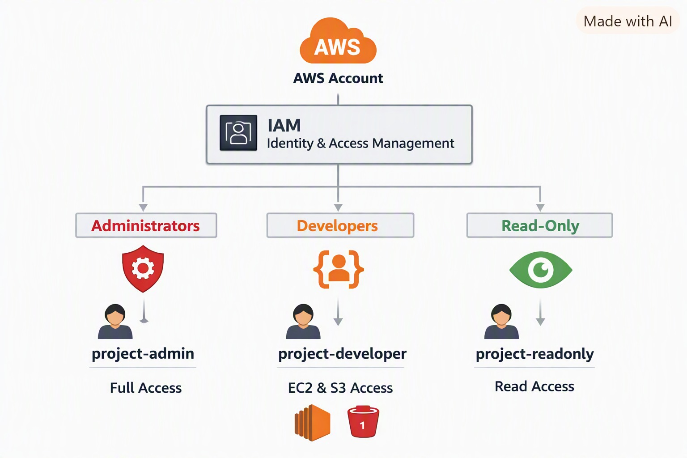

```
IAM Users  ->  IAM Groups  ->  IAM Policies  ->  AWS Services (EC2, S3, CloudWatch, IAM)
```

AWS denies everything by default. An explicit Allow grants access, and an explicit Deny always overrides an Allow.

## Access Design

| Group          | User(s)                  | Policy                              | Access                                         |
| -------------- | ------------------------ | ----------------------------------- | ---------------------------------------------- |
| Administrators | `admin-user`             | `AdministratorAccess` (AWS managed) | Full access to all services and IAM            |
| Developers     | `dev-user1`, `dev-user2` | `Developers-Custom-Policy` (custom) | EC2, S3, CloudWatch, Lambda; no IAM or billing |
| ReadOnly       | `readonly-user`          | `ReadOnlyAccess` (AWS managed)      | View only, no create/modify/delete             |

## Implementation Steps

**1. Open the IAM dashboard**

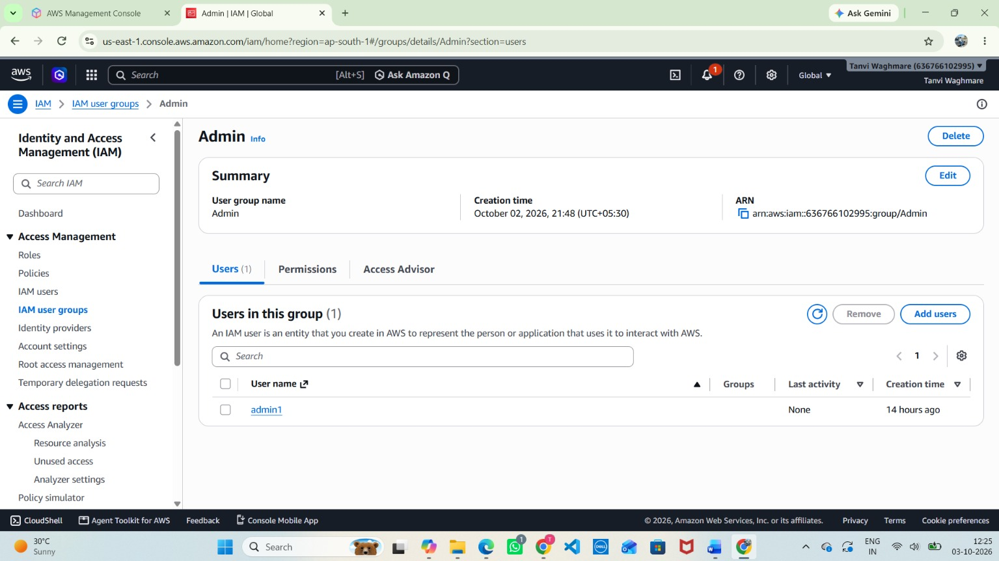

**2. Create groups:** `Administrators`, `Developers`, `ReadOnly`

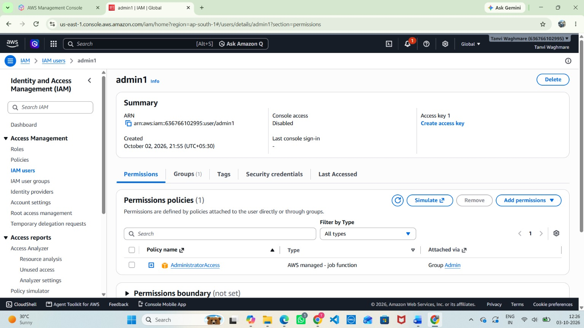

**3. Attach `AdministratorAccess` to Administrators**


**4. Create and attach the custom Developers policy** (JSON below)

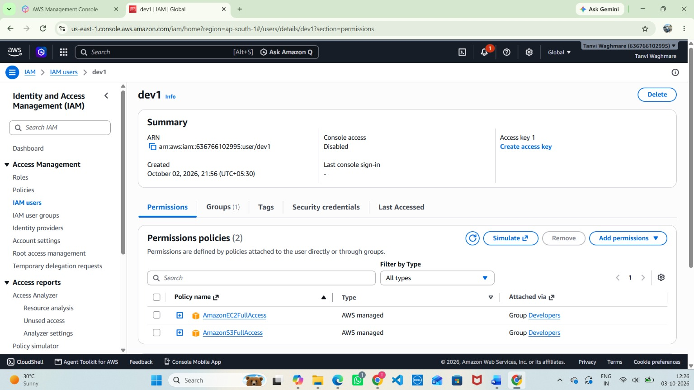

**5. Attach `ReadOnlyAccess` to ReadOnly**

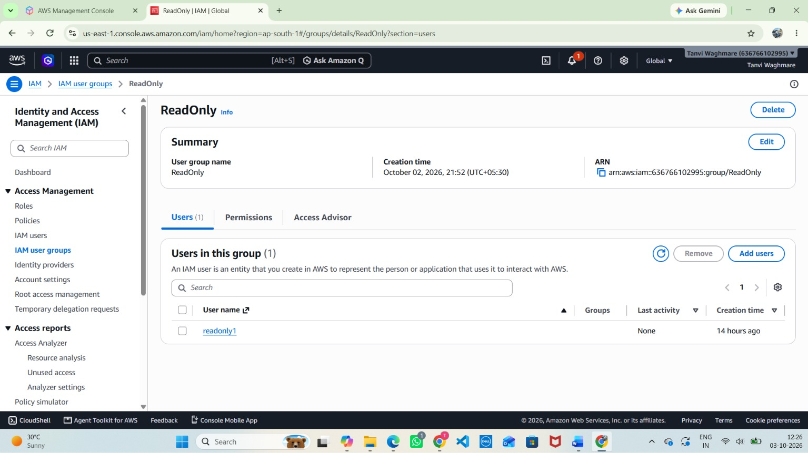

**6. Create IAM users** with console access and "reset password at next sign-in"

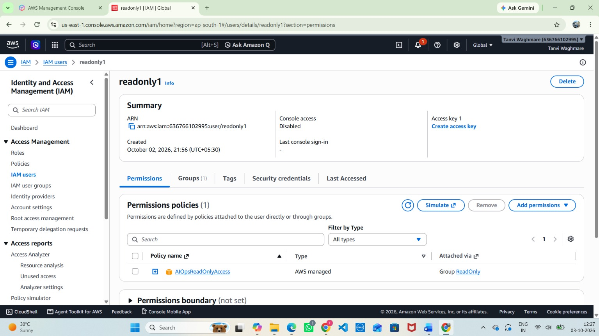

**7. Add each user to the correct group and verify membership**

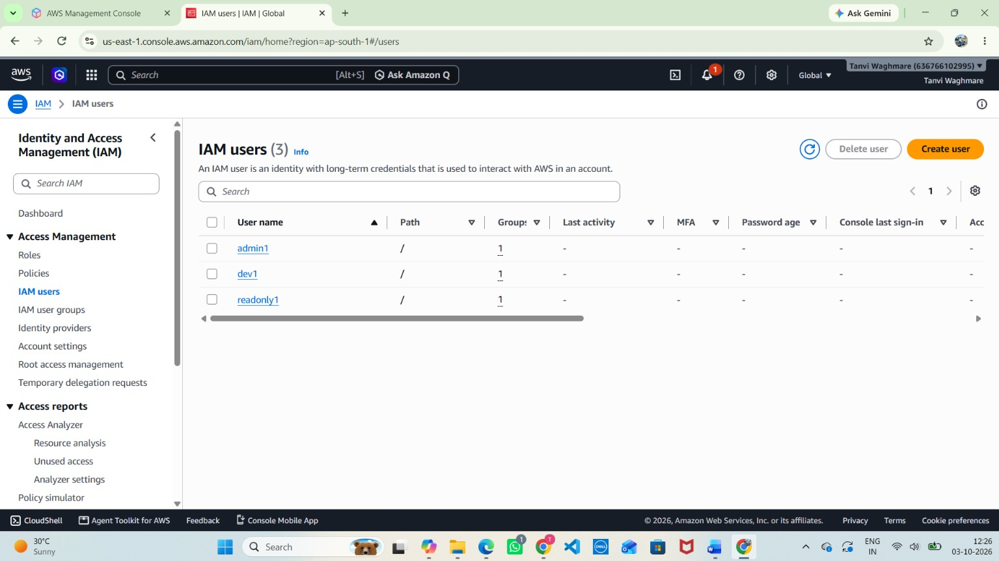

## Developers Custom Policy

```json
{
  "Version": "2012-10-17",
  "Statement": [
    {
      "Sid": "AllowDevServices",
      "Effect": "Allow",
      "Action": ["ec2:*", "s3:*", "cloudwatch:*", "logs:*", "lambda:*"],
      "Resource": "*"
    },
    {
      "Sid": "DenyIAMAndBilling",
      "Effect": "Deny",
      "Action": ["iam:*", "aws-portal:*", "billing:*", "organizations:*"],
      "Resource": "*"
    }
  ]
}
```

## Testing: Permitted vs Denied

Sign in as each user through the IAM sign-in URL (`https://<account-id>.signin.aws.amazon.com/console`) in separate incognito windows.

**Administrator:** creates IAM users, launches EC2, creates S3 buckets. All allowed.

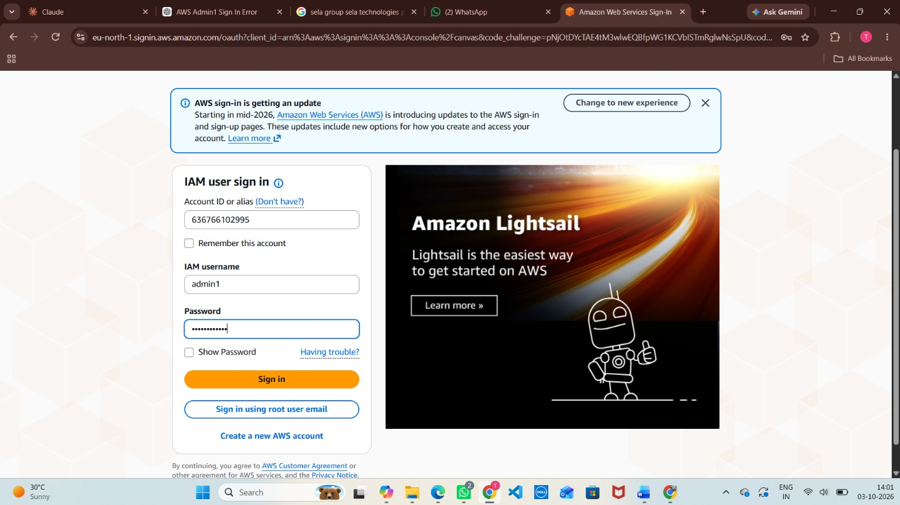

**Developer:** launches EC2 and creates S3 buckets (allowed), but is denied creating IAM users.

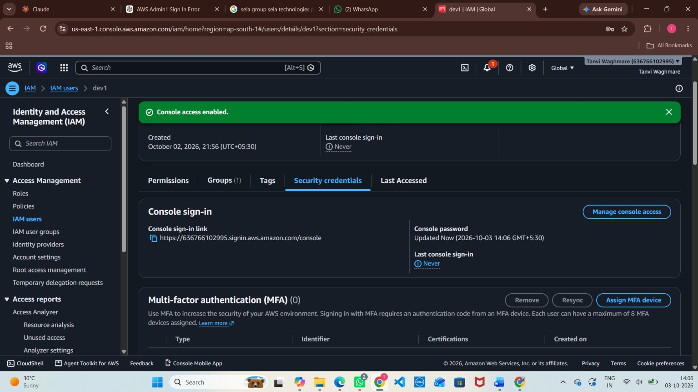
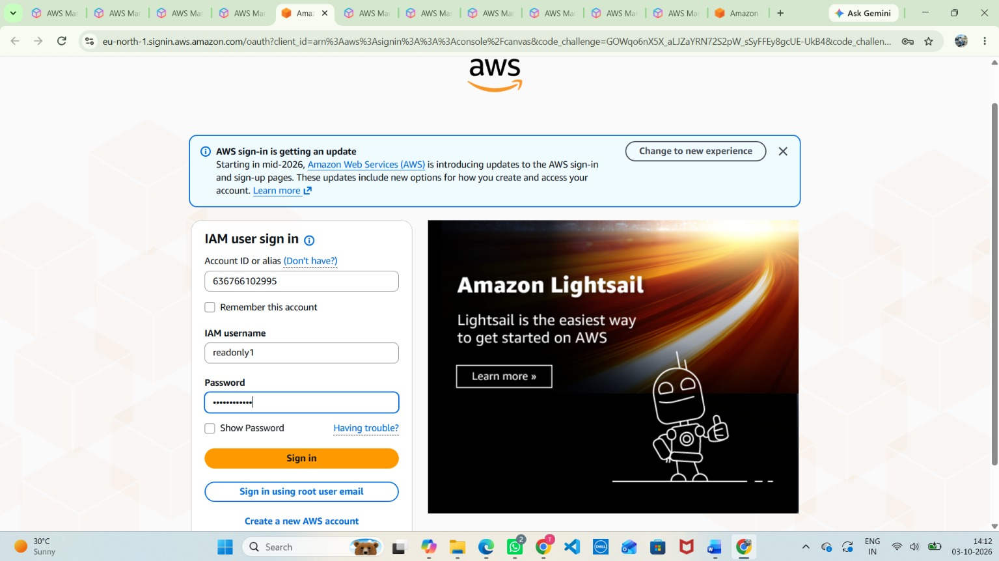

**Read-Only:** views EC2, S3, and IAM (allowed), but is denied launching or creating anything.

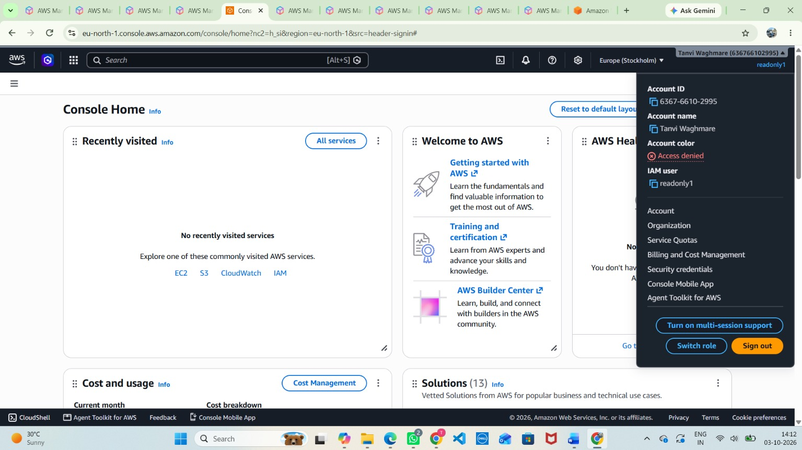
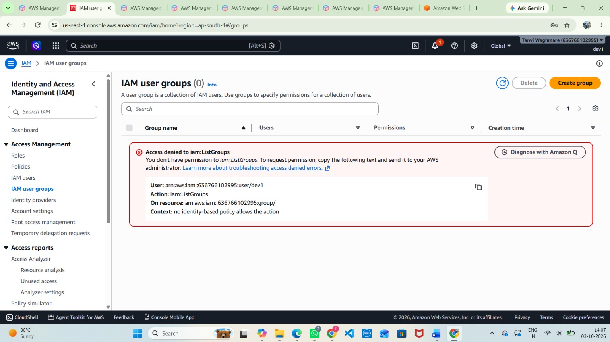

## Results Summary

| Operation           |  Admin  | Developer | Read-Only |
| ------------------- | :-----: | :-------: | :-------: |
| View EC2 / S3 / IAM | Allowed |  Allowed  |  Allowed  |
| Launch EC2 instance | Allowed |  Allowed  |  Denied   |
| Create S3 bucket    | Allowed |  Allowed  |  Denied   |
| Create IAM user     | Allowed |  Denied   |  Denied   |
| Access billing      | Allowed |  Denied   |  Denied   |

## Security Practices

- Least privilege: each group gets only what its role needs
- Policies attached to groups, never directly to users
- Explicit Deny guardrails for developers
- Root account not used for daily work
- Forced password reset on first login; MFA for admins

## Cleanup

Terminate test EC2 instances, delete test S3 buckets, then remove users, groups, and the custom policy from IAM.

## Conclusion

Group-based IAM gives each role exactly the access it needs. Administrators manage everything, developers build without touching IAM or billing, and read-only users can inspect but not change.
